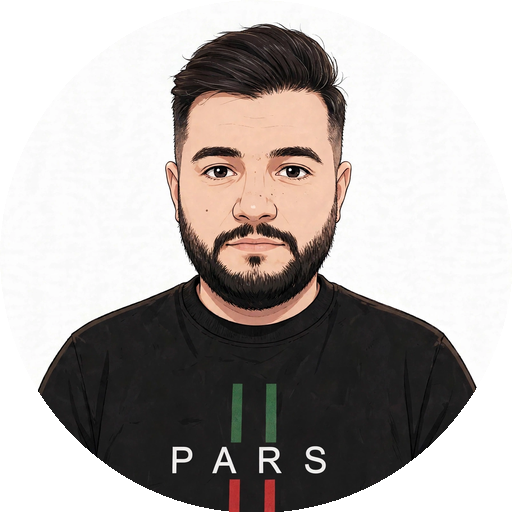

<!-- Typing intro -->

  
  
  

---

### 👨‍💻 About Me

> Java developer with **7+ years** of experience — building solid backends with **Spring**, different databases and architectures, and now going deep into **AI Engineering** by building, not just studying.

- 🔭 Currently building the backend of **mcp-bot-org** — a Persian AI assistant for daily tasks — with **Java 25, Spring Boot 4 & Keycloak**
- 🤖 Building **Kanal** — a Persian-first personal AI chatbot (FastAPI, Tavily web search, ~4500 lines of tests)
- 🌱 Learning: **LLMs, Agents, Evals & Workflows**
- 💬 Ask me about **Java, Spring Boot, PostgreSQL, Keycloak, Docker & AI Agents**
- 📫 Reach me: **ali.sameni.3456@gmail.com**
- 📍 **Tehran, Iran**

---

### 🛠️ Tech Stack

**Backend**
 

**AI & Agents**
 

**Database & DevOps**
 

---

### 🚀 Featured Projects

| Project | What it is | Stack |
|---|---|---|
| [**Kanal**](https://github.com/Alisameni/Kanal) | Persian-first personal AI chatbot — CLI, web search, save-research with explicit confirmation | Python · FastAPI · Tavily |
| [**mcp-bot-org / web**](https://github.com/mcp-bot-org/web) | Backend of a Persian AI assistant — auth, users, wallet, subscriptions & admin | Java 25 · Spring Boot 4 · Keycloak · PostgreSQL |
| [**SpringSecurity**](https://github.com/Alisameni/SpringSecurity) | Spring Security example | Java · Spring Boot |
| [**CrudDemoSpringBoot**](https://github.com/Alisameni/CrudDemoSpringBoot) | Simple CRUD demo with Spring Boot & Java console | Java · Spring Boot |

---

### 📊 GitHub Stats

 

 

 

---

### 🤝 Let's Connect

  

> *"First, solve the problem. Then, write the code."* — John Johnson

